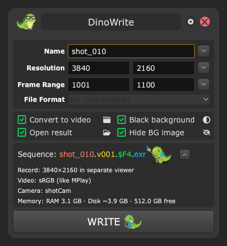
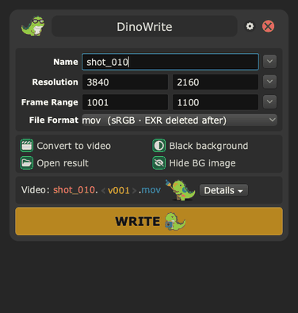
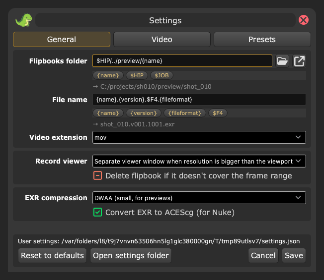
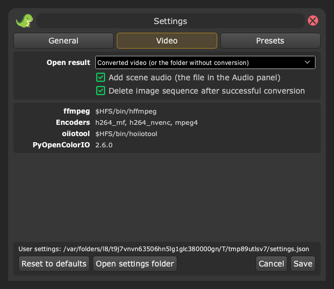
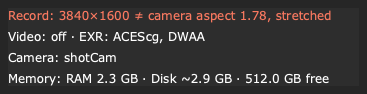
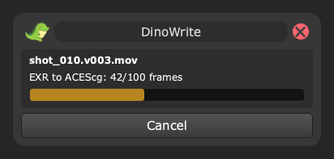

# DinoWrite

Write flipbooks to disk easily. A pure Python tool for Houdini.

<p align="center">
  
  
</p>

## Features
---
 - Folders are automatically versioned (`v001`, `v002`, ...)
 - True resolution: a 4K flipbook on a 2K monitor is recorded in a torn off copy of the viewer sized to 4K (bigger than the screen) instead of stretching the viewport
 - Convert the sequence to video in the background with ffmpeg that ships with Houdini: Houdini stays usable, a small window shows progress and can cancel
 - Video colors match MPlay right after recording, EXR are converted to ACEScg for Nuke/comp
 - Kept EXR are compressed with DWAA (several times smaller) and carry a flipbook passport in the header: hip, camera,
   frame range, OCIO view, user, date. The video carries the same passport in its metadata
 - Scene audio (the file in Houdini's Audio panel) goes into the video, synced like in the playbar
 - Memory line: RAM for MPlay and the disk space the flipbook needs vs free space (orange/red when it may not fit)
 - Status line shows how the flipbook will be recorded and encoded, flipbook name is checked while typing.
   The details slide out with the arrow next to the sequence name (closed by default, remembered); while they're
   closed, a warning (stretched aspect, not enough disk space) colors the arrow
 - Opens the result when done: the converted video or the folder
 - Settings dialog behind the gear button, your settings survive tool updates
 - Remembers last used values
 - Animations in the HotBox style: windows fade in/out, window parts come in one after another; on hover a white
   wave spreads from the cursor and the button gets lighter and a bit bigger; checkboxes glow on hover and flash on
   toggle; changed info text blinks in; a wrong name shakes; the dino hops on a new name/version; menus fade in
 - Supports multiple viewports
 - Shows existing flipbooks (can grab their name)
 - Grabs resolution from the camera (OBJ camera, or Solaris render settings / USD camera) or divides it; warns when the resolution would stretch the image
 - Works with Houdini 21+ (PySide6 / Qt6) and older Qt5 builds (PySide2)

## Installation
---
1. Download the source and put the `DinoWrite` folder into the Python path of your Houdini preferences
   (for Houdini 21 it's `python3.11libs`, create it if missing):

| os | location |
|---|---|
| win | `%USERPROFILE%/Documents/houdini21.0/python3.11libs/DinoWrite` |
| linux | `$HOME/houdini21.0/python3.11libs/DinoWrite` |
| mac | `$HOME/Library/Preferences/houdini/21.0/python3.11libs/DinoWrite` |

   Or keep it anywhere and add its **parent** folder to `PYTHONPATH` with a
   [Houdini package](https://www.sidefx.com/docs/houdini/ref/plugins.html), e.g. `packages/DinoWrite.json`:

```json
{
    "env": [{"PYTHONPATH": "/path/to/folder/that/contains/DinoWrite"}]
}
```

2. Create a shelf tool with this script:

```python
import DinoWrite
DinoWrite.show(kwargs)
```

The folder must be named `DinoWrite`, it's the package name.
Old shelf tools with `from DinoWrite import ui; ui.DinoWriter(kwargs)` keep working.

Run the tool from a Scene Viewer's shelf/hotkey to record that viewer when there are several.

## Settings
---
Click the gear button in the window title. Tabs:

<p align="center">
  
  
</p>

| tab | what |
|---|---|
| General | flipbooks folder (folder button: choose it, `$JOB`/`$HIP` are put back into the path; arrow button: open it), file name template (click a variable chip to insert it, the line below shows what it turns into), video extension, recording viewer, EXR compression, incomplete flipbook cleanup, ACEScg |
| Video | what to open after writing, scene audio, sequence cleanup; shows which ffmpeg and encoders are found |
| Presets | resolution and frame range presets for the dropdown menus |

ffmpeg path, encoder and the ffmpeg command template (`advanced.ffmpeg_path`, `advanced.video_codec`, `ffmpeg_cmd`)
are only in the settings file: they work out of the box.

Defaults live in `settings.json` inside the tool folder. Your changes are saved separately to
`$HOUDINI_USER_PREF_DIR/DinoWrite/settings.json` (or the path in `$DINOWRITE_SETTINGS`) and contain only the values
that differ from defaults, so updating the tool doesn't wipe them. "Reset to defaults" removes that file.
Last used window values are kept next to it in `last_used.json`.

### Recording viewer
`advanced.true_resolution`:
- `auto` (default): records in the maximized viewport when the resolution fits, otherwise in a floating copy of the viewer sized to the resolution (toolbars hidden, same camera), which is closed afterwards. Background color / background image toggles apply only to the copy
- `always`: always records in the copy
- `off`: maximized viewport, Houdini scales the image to the resolution

Solaris (LOP) viewers are always recorded in the maximized viewport: Solaris keeps its lighting (Headlight Only...) in options that can't be copied, a viewer copy would record with Normal Lighting. "Black background" and "Hide BG image" are greyed out there: setting any viewport display option from Python in Solaris resets the lighting (Houdini bug).

Some OSes (macOS, some Linux window managers) don't allow windows bigger than the screen: then a warning is logged and the image is scaled as before. On HiDPI screens a 4K viewport fits into a smaller window.

### Camera resolution
"Camera Resolution" in the resolution menu:
- OBJ / SOP: `resx` × `resy` of the camera the viewport looks through
- Solaris (LOP): the render settings the stage uses (`renderSettingsPrimPath`, set by Karma Render Settings), else the
  one whose camera is the viewport camera. Values are read at the current frame: in "Set Width, Compute Height from
  Camera" mode Karma writes the resolution as time samples over a default 2048×1080. Without render settings:
  the viewport width and the USD camera aspect (`horizontalAperture / verticalAperture`), as the viewer shows it
- no camera: the viewport size

Houdini stretches the camera image to the flipbook resolution, so a resolution with another aspect than the camera
comes out squashed. The status line turns orange before recording:

<p align="center">
  
</p>

### Colors: video and EXR
A viewport flipbook stores the viewport image as you see it (OCIO display/view, e.g. Rec.1886 / ACES SDR, already
applied), linearized with the inverse sRGB curve. "Beauty pass only" is switched off while recording, so it's always
the viewport as seen.

The File Format menu shows the colorspace each format is written in, the tooltip says how to read it in Nuke:
`exr (ACEScg)`, `exr (Linear Rec.709)` when ACEScg is off or not possible, `exr (temporary)` when the sequence is
deleted after the video, `png`/`jpg (<viewer view>)`: the viewport look as is (e.g. `ACES 1.0 - SDR Video`), `sRGB`
without OCIO.

- **Video** is encoded from the recorded EXR with the sRGB curve (like "EXR Transfer Func" of the FFmpeg Encode Video
  TOP): it looks like MPlay right after recording. JPG/PNG are encoded as is. Tagged BT.709 / sRGB.
- **EXR → ACEScg** (`advanced.exr_acescg`, on by default, Settings → General): the kept EXR are converted back to
  scene-linear ACEScg with the inverse of the viewer's display/view: the exact transform is baked with PyOpenColorIO
  into a `.ctf` and applied by `hoiiotool` (both ship with Houdini). In Nuke with an ACES config read them as ACEScg (the default for EXR) and view with the same display/view
  as the Houdini viewer: the picture is the same as in the viewport. Highlights are limited to what was on screen,
  it's a preview, not a render. Skipped when the viewer doesn't use OCIO, the config isn't an ACES one,
  hoiiotool or PyOpenColorIO aren't found, or the sequence is deleted after the video. If it fails, the EXR stay as recorded.

- **EXR compression** (`advanced.exr_compression`: `dwaa` default, `zip`, `piz`, `none`): applied in the same
  hoiiotool pass, also when ACEScg is off or not possible.

### Flipbook passport
Where a flipbook came from, written right after recording: `hip`, `camera`, `frame_range`, `resolution`, `fps`,
`ocio_view`, `audio`, `user`, `host`, `date`, `houdini`, `dinowrite`.
- EXR: header attributes `dinowrite:hip`, ... (Nuke: Read node → Metadata tab, `exr/dinowrite:hip`), plus the
  standard owner and comments
- Video: `title`, `artist`, `comment`, `date` and `dinowrite_hip`, ... (`ffprobe`, a player's media info)

### Scene audio
`advanced.video_audio` (on by default, Settings → Video): the file set in Houdini's Audio panel (playbar sound) goes
into the video, synced like in the playbar (Audio panel "sync frame" and offset). The video keeps its length:
shorter sound is padded with silence. CHOP audio isn't supported. Nothing happens when no file is set.

After recording, video and the EXR pass run in the background, Houdini stays usable:

<p align="center">
  
</p>

### Video codec
`advanced.video_codec`: `auto` (default) or an encoder name. ffmpeg that ships with Houdini (`hffmpeg`) is built
without GPL parts and has **no libx264**, so `auto` asks ffmpeg which encoders it has and tries
`libx264` → `h264_videotoolbox` (macOS) → `h264_mf` (Windows) → `h264_nvenc` / `h264_amf` / `h264_qsv` → `mpeg4`,
moving to the next one if an encoder fails. The `{codec}` line in the ffmpeg command expands to the encoder arguments, `{audio_input}` / `{audio}` to the scene
sound, `{metadata}` to the passport.

### Tools lookup
- ffmpeg: `advanced.ffmpeg_path` → `$PDG_FFMPEG` → `$HFS/bin/hffmpeg` (ships with Houdini) → system PATH
- oiiotool: `advanced.oiiotool_path` → `$HFS/bin/hoiiotool` → `hoiiotool` / `oiiotool` in system PATH

### Attentions
- After a successful conversion the image sequence is deleted (`conversion_delete_input_sequence`, on by default). Only frames of that sequence are removed, other files in the folder are kept. Cancelled or failed conversion always keeps the sequence
- `delete_incomplete_fb` (off by default) deletes a sequence that doesn't cover the frame range
- Sequences are written in native pixel aspect, Houdini flipbooks can't write it with the original resolution. Fix it in Nuke with a Reformat node; ffmpeg conversion applies the pixel aspect to the video

## Tips
---
1. Off background image is useful when working with film footage and shot timing: later you can easily merge your flipbooks with the shot source footage.
2. Black background gives a little improvement when merging with the source.
3. Version in the file name lets you see the flipbook version in Nuke without going inside the Read node. Select the Read node and press Alt+Up/Down to switch versions.

## Development
---
Local development uses [uv](https://docs.astral.sh/uv/). Houdini doesn't need it, it imports the folder directly.

```
uv sync            # create .venv with dev tools (pytest, ruff, PySide6)
uv run pytest      # run tests
uv run ruff check  # lint
uv run --with pillow python docs/make_images.py   # README images (docs/)
```

Tests replace `hou` with a stub and build the real window offscreen with PySide6 (Qt6, as in Houdini 21).
The repo folder must be named `DinoWrite` for tests to import the package.

In Houdini, `DinoWrite.show(kwargs, reload=True)` reloads all modules to pick up code changes without a restart.

Project layout:

| path | what |
|---|---|
| `__init__.py` | `show()` entry point, `reload_modules()` for development |
| `main.py` | main window |
| `ui.py` | backward compatible import for old shelf tools |
| `flipbook.py` | recording (incl. torn off viewer) and conversion pipeline |
| `config.py` | settings: defaults + user overrides |
| `settings.json` | default settings |
| `core/` | Houdini logic without Qt |
| `core/viewport.py` | Scene Viewer wrapper, torn off copy at true resolution |
| `core/ffmpeg.py` | ffmpeg lookup, command and color filters |
| `core/conversion.py` | after recording: video (encoder fallback, audio, passport) → EXR pass, polled without blocking |
| `core/acescg.py` | EXR pass via hoiiotool: ACEScg (inverse of the viewer's OCIO display/view), compression, passport |
| `core/passport.py` | flipbook passport for EXR headers and video metadata |
| `core/audio.py` | scene audio from the Audio panel, ffmpeg sync arguments |
| `core/process.py` | polled external process (no threads: hou is not thread safe) |
| `core/helpers.py`, `core/log.py` | versions, frame/name parsing, logging |
| `gui/` | Qt: `qt.py` (PySide6/PySide2), theme, frameless windows, widgets, animations, settings dialog, progress window |
| `icons/`, `misc/` | icons and font |
| `tests/` | pytest suite |
| `docs/` | README images and `make_images.py` that renders them offscreen with the real widgets |

## Credits
---
- [Alexander Marchenko](https://www.linkedin.com/in/cg-alexander-marchenko/)
- Alexandra Ushakova
